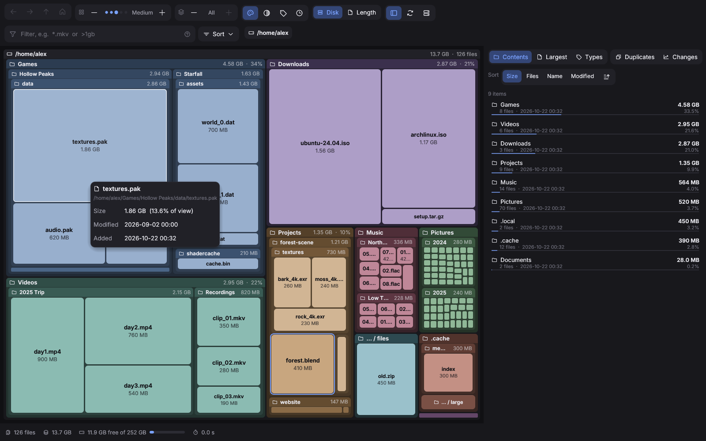
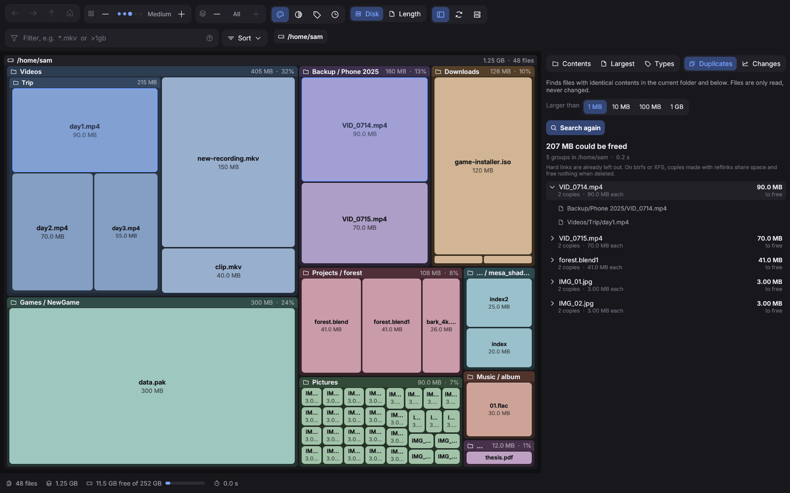
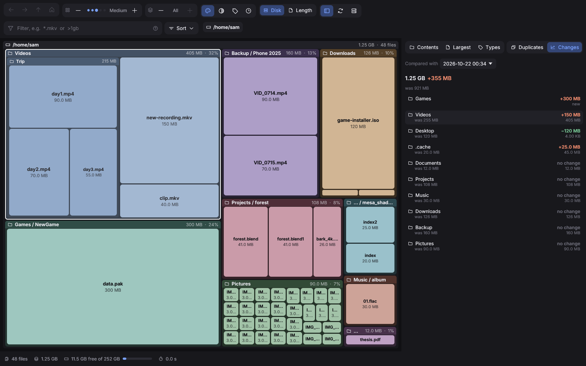
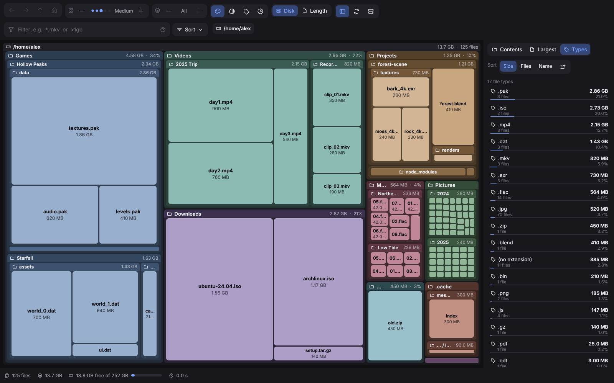
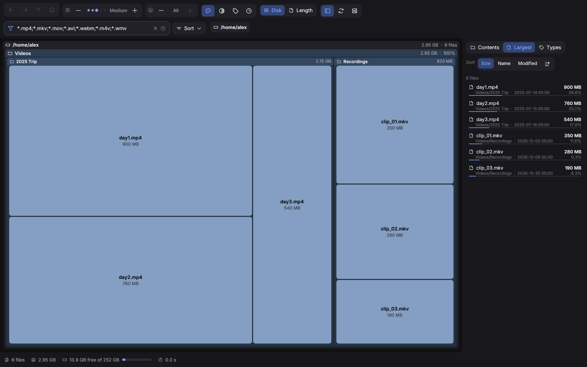
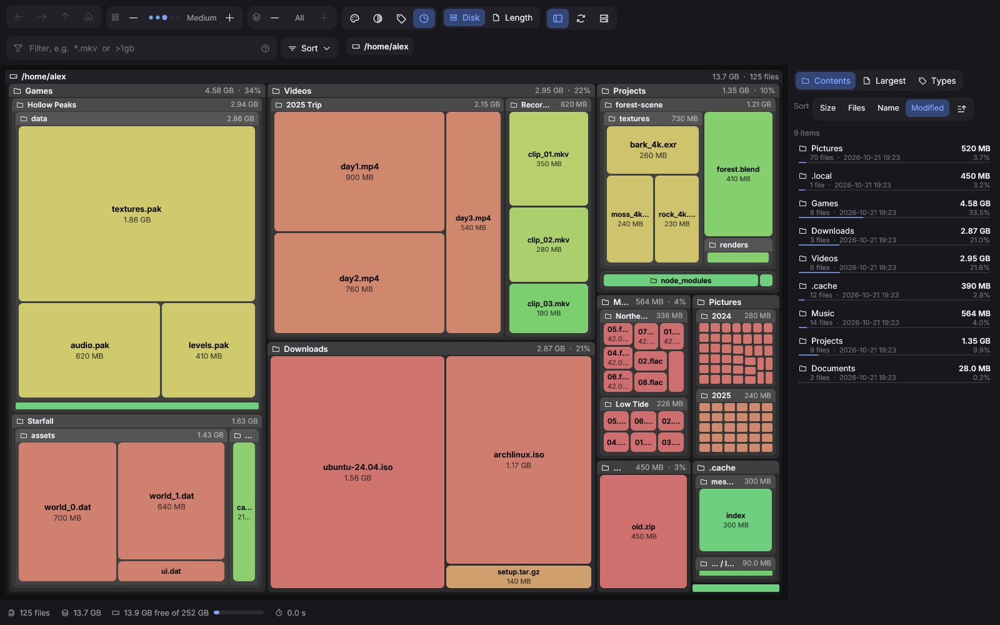

<p align="center">
  
</p>

<h1 align="center">Spacemapper</h1>

<p align="center">Disk usage viewer for Linux, Windows and macOS that shows your files as a treemap.</p>

<p align="center">
  <a href="https://github.com/Martin-ii/spacemapper/releases/latest">Download</a> ·
  <a href="#installation">Installation</a> ·
  <a href="#usage">Usage</a> ·
  <a href="#building-from-source">Building</a>
</p>



Spacemapper scans a drive or folder and draws every file and folder as a box. The size of a box matches the space it takes up, so large files and folders stand out right away. Folders contain their subfolders and files, and you can zoom in and out to look at any part in more detail.

It works like SpaceSniffer. Spacemapper only reads your files: it has no option to delete, move or rename them, so you can look around without risk. The only files it writes are its own settings and scan summaries (see [Files Spacemapper writes](#files-spacemapper-writes)).

## Features

- Treemap of a whole drive or a single folder, zoomable with mouse or keyboard
- Side list with folder contents, largest files and space per file type, sortable by size, number of files, name or date
- Duplicate finder: files with identical contents, sorted by how much space they waste
- Changes since an earlier scan: which folders grew or shrank
- Filters by name, path, size, emptiness, hidden files and three kinds of age (modified, added to the disk, last opened)
- About 35 ready-made filters, for example large files, files added this week, shader caches, browser caches, logs, Steam games, Flatpak data and virtual machines
- Colors by top-level folder, file type or age, or plain grayscale
- Free space and unreadable space shown when scanning a whole drive
- Full access option to include system folders (asks for your administrator password)
- Open files or show them in your file manager (Explorer on Windows, Finder on macOS) from the right-click menu
- Fast multithreaded scanning; sizes match `du`
- JSON output (`spacemapper --json FOLDER`) for scripts and other programs
- Remembers your view settings
- Runs on Linux (Wayland and X11), Windows 10 and 11, and macOS on Apple Silicon

| Duplicates | Changes since an earlier scan |
|---|---|
|  |  |

| File types | Filter | Colored by age |
|---|---|---|
|  |  |  |

## Installation

Spacemapper runs on 64-bit (x86_64) Linux with glibc 2.28 or newer, which covers every distribution released since 2019, on 64-bit Windows 10 and 11, and on macOS with Apple Silicon.

### Windows

Download `Spacemapper-VERSION-windows-x64.exe` from the [Releases](https://github.com/Martin-ii/spacemapper/releases/latest) page and double-click it. Nothing is installed: it is a single program file that you can keep anywhere, for example in your Documents folder. To have it in the Start menu, right-click the file and choose **Pin to Start**. To remove Spacemapper, delete the file.

The program is not signed, so the first time you start it Windows may show "Windows protected your PC". Click **More info**, then **Run anyway**.

### macOS

Download `Spacemapper-VERSION-macos-arm64.zip` from the [Releases](https://github.com/Martin-ii/spacemapper/releases/latest) page and double-click it to unpack it. Drag `Spacemapper.app` into your Applications folder. It runs on Macs with Apple Silicon (M1 and newer). To remove Spacemapper, delete the app.

The app is not notarized, so the first time you start it macOS refuses to open it. Open the app once and close the warning. Then open **System Settings**, **Privacy & Security**, scroll down to the **Security** section, click **Open Anyway** and confirm (it may ask for your password).

On its first start, Spacemapper offers to open the **Full Disk Access** settings. Turn on Spacemapper there and start it again, so it can include folders such as Mail and Photos (see [Full access](#full-access)).

On an external display, a full-screen or maximized Spacemapper window sometimes ignores a click, and a second click works. This comes from the window library ([winit issue #4295](https://github.com/rust-windowing/winit/issues/4295)). A normal-sized window on the same display is not affected.

To build the app yourself, see [Building from source](#building-from-source).

### Linux: quick install

Open a terminal and run:

```sh
curl -fsSL https://raw.githubusercontent.com/Martin-ii/spacemapper/main/get.sh | sh
```

This downloads the latest release and installs it with your package manager on Arch, CachyOS, Manjaro, Debian, Ubuntu, Linux Mint, Fedora and openSUSE (you will be asked for your password). On other distributions it installs Spacemapper for your user in `~/.local`. Run the same command again to update to a newer version. You can [read the script](get.sh) before running it.

### Linux: manual install

The packages are on the [Releases](https://github.com/Martin-ii/spacemapper/releases/latest) page. The commands below assume the downloaded file is in your Downloads folder.

#### AppImage (any distribution, no installation)

Download `Spacemapper-VERSION-x86_64.AppImage`, make it executable and run it:

```sh
cd ~/Downloads
chmod +x Spacemapper-*-x86_64.AppImage
./Spacemapper-*-x86_64.AppImage
```

You can also right-click the file in your file manager, open Properties, allow it to run as a program, and double-click it. Nothing is installed; to remove Spacemapper, delete the file.

If it does not start and mentions FUSE, install FUSE 2 (`sudo apt install libfuse2` on Debian and Ubuntu, `sudo dnf install fuse-libs` on Fedora, `sudo pacman -S fuse2` on Arch), or start it with `--appimage-extract-and-run` added after the file name.

#### Debian, Ubuntu, Linux Mint, Pop!_OS, elementary OS, Zorin OS

Download `spacemapper_VERSION-1_amd64.deb`, then run:

```sh
cd ~/Downloads
sudo apt install ./spacemapper_*_amd64.deb
```

You can also double-click the file to open it in your software center.

To uninstall: `sudo apt remove spacemapper`

#### Fedora, RHEL, Rocky Linux, AlmaLinux

Download `spacemapper-VERSION-1.x86_64.rpm`, then run:

```sh
cd ~/Downloads
sudo dnf install ./spacemapper-*.x86_64.rpm
```

To uninstall: `sudo dnf remove spacemapper`

#### openSUSE

Download `spacemapper-VERSION-1.x86_64.rpm`, then run:

```sh
cd ~/Downloads
sudo zypper install --allow-unsigned-rpm ./spacemapper-*.x86_64.rpm
```

To uninstall: `sudo zypper remove spacemapper`

#### Arch Linux, CachyOS, EndeavourOS, Manjaro

Download `spacemapper-VERSION-1-x86_64.pkg.tar.zst`, then run:

```sh
cd ~/Downloads
sudo pacman -U spacemapper-*-x86_64.pkg.tar.zst
```

To uninstall: `sudo pacman -R spacemapper`

To build the package yourself instead, see [Arch package from source](#arch-package-from-source).

#### Any other distribution

Download `spacemapper-VERSION-x86_64.tar.gz` and extract it:

```sh
cd ~/Downloads
tar xzf spacemapper-*-x86_64.tar.gz
cd spacemapper-*/
```

You can run it straight from this folder with `./spacemapper`. To add it to your application menu:

```sh
./install.sh          # for your user only, installs to ~/.local
sudo ./install.sh     # for all users, installs to /usr/local
```

To uninstall, run the same command with `--remove`, for example `./install.sh --remove`.

### Requirements

The packages above install these automatically. With the tar.gz you need:

- OpenGL (Mesa or your graphics driver) and EGL
- libxkbcommon and libwayland-client
- For X11 sessions: libxkbcommon-x11, libXcursor and libXi
- Optional: `xdg-utils` to open files, `polkit` (pkexec) for full access scans

These are already installed on almost every desktop system.

## Usage

Start Spacemapper from your application menu, or from a terminal:

```sh
spacemapper                    # opens the drive list
spacemapper ~/Downloads        # scans a folder directly
```

On the start screen, click **Scan** next to a drive, or enter a folder path. You can also drag a folder onto the window.

### Navigating

| Action | Mouse | Keyboard |
|---|---|---|
| Zoom into a folder | Double-click, or scroll up over it | Enter (on a selected item) |
| Show one more level inside a folder | Click a folder cut off by the level limit (click its header to close it again) | |
| Zoom out one level | Scroll down | U or Alt+Up |
| Back / forward | Mouse back / forward buttons | Backspace, Alt+Left / Alt+Right |
| Go to the top level | House button | Home |
| Jump to a parent folder | Click it in the path bar | |
| Select an item | Click | |
| Context menu | Right-click | |
| Show in file manager (Finder on macOS) | Middle-click | |
| Rescan | Rescan button | F5 |
| Show or hide the side list | List button | L |
| Focus the filter box | | Ctrl+F (Cmd+F on macOS) |

The right-click menu has: Show in file manager (Show in Finder on macOS), Open, Zoom in, Zoom out, Copy path, Copy name and Rescan this folder.

### Toolbar

From left to right:

- **Navigation**: back, forward, up one level, top level
- **Detail** (− and +, or keys `[` and `]`): how small a box can get before small items are combined into one box labelled "N small items". More detail shows more individual files.
- **Levels** (− and +, or keys `-` and `+`): how many folder levels are drawn inside each other. With few levels you can still look inside a single folder: click it to show one more level in it, without changing the rest of the map.
- **Colors**: by top-level folder, grayscale, by file type, or by age (green for recent, red for old). In age mode a menu next to the buttons chooses which date is used: Added, Modified or Opened (see [Dates](#dates)).
- **Disk / Length**: show the space used on disk, or the file sizes. They differ for compressed, sparse and very small files.
- **Free / Unknown**: show or hide free space and unknown space (only when scanning a whole drive)
- **List**, **Rescan** and **Drives** (back to the start screen)

Folders that only contain a single subfolder are drawn as one box, for example `lib / python3.13 / site-packages`.

### Side list

- **Contents**: the files and folders in the current view
- **Largest**: the 500 largest files in the current view and below it
- **Types**: space used per file extension. Click a type to filter the treemap to it.
- **Duplicates**: see below
- **Changes**: see below

In the first three, click a column name (Size, Files, Name, Modified) to sort by it, and click it again to reverse the order. Hovering over a row highlights the item in the treemap, and double-clicking opens it.

### Duplicates

Click **Find duplicates** to look for files with identical contents in the current folder and everything below it. Choose a minimum size first (1 MB, 10 MB, 100 MB or 1 GB); smaller limits find more but take longer.

Spacemapper compares files in three steps: by size, by their first 64 KB, and only then by their full contents, so most files are never read completely. The results are sorted by the space you would free by keeping only one copy. Click a group to see where the copies are, hover over a copy to highlight it in the treemap, click it to show it there, or double-click to open its folder in your file manager.

Hard links are already counted once and never show up as duplicates. On btrfs and XFS, copies made with reflinks (for example `cp --reflink`) share their data, so deleting one of them frees nothing.

### Changes

After every complete scan, Spacemapper saves a small summary of the folder sizes. When you scan the same folder again later, the **Changes** tab shows how much each folder grew or shrank compared with an earlier scan. Pick which earlier scan to compare with in the menu at the top; the last 10 are kept. Double-click a folder to see the changes inside it.

Folders that were smaller than 1 MB in the earlier scan are not stored, so a folder that grew from almost nothing is marked "was under 1 MB" instead of showing an exact change.

### Filters

Type into the filter box, or pick one of the ready-made filters from the **Sort** menu next to it. Separate several terms with `;`.

| Term | Shows |
|---|---|
| `*.mkv;*.mp4` | files matching any of these patterns |
| `cache` | files whose name contains "cache" |
| `/node_modules/` | files whose path contains this (a term with `/` is matched against the full path) |
| `!*.log` | everything except matching files |
| `>100mb` | files larger than 100 MB (units: kb, mb, gb, tb) |
| `<2gb` | files smaller than 2 GB |
| `>1y` | files whose contents were not modified for more than a year |
| `<7d` | files modified in the last 7 days |
| `added>1y` | files that have been on this disk for more than a year |
| `added<7d` | files added to this disk (or changed) in the last 7 days |
| `opened>1y` | files not opened for more than a year (see [Dates](#dates)) |
| `empty` | files of 0 bytes |
| `hidden` | hidden files, and files inside hidden folders |

Age units are h (hours), d (days), w (weeks), mo (months) and y (years). `modified>1y` is the same as `>1y`.

Terms can be combined. For example, `*.mkv;*.mp4;>1gb;added>6mo` shows video files over 1 GB that have been on the disk for more than six months.

The **Sort** menu groups the ready-made filters into Size, Age, File types, Cleanup candidates (caches, shader caches, browser caches, thumbnails, package caches, build folders, logs, crash dumps, trash), Apps and games (Steam, Wine and Proton prefixes, Flatpak, Snap, containers, virtual machines) and Other. On Windows the cleanup and app filters cover Windows folders instead, such as temporary files, Windows Update downloads, the Recycle Bin, `Windows.old`, the page file, game launchers and WSL.

### Dates

Every file has three dates, and the age filters and colors can use any of them:

- **Modified**: when the contents last changed. Files from packages, downloads and archives usually keep the date their author gave them, so a program you installed today can have a modified date from years ago.
- **Added**: when the file was put on this disk or last changed, whichever is later. This is usually what you want for "old files I no longer need", and it is the default for the age colors.
- **Opened**: when the file was last read. Linux only records this when the drive is mounted without the `noatime` option. Many systems use `noatime`, especially on btrfs. You can check with `findmnt -no OPTIONS /`. Spacemapper detects it and shows a warning instead of wrong results. Windows does not reliably record this date either, so the "opened" filters are turned off there.

On Windows, **Added** uses the date the file was created on this drive, which is when it was copied, downloaded or installed.

### Free and unknown space

When you scan a whole drive, two extra boxes appear:

- **Free space** is the space still available on the drive.
- **Unknown** is used space that the scan could not read. This is mostly system folders that your user has no permission to open, plus btrfs snapshots and filesystem metadata. On macOS it also includes the hidden Preboot and Recovery volumes.

### Full access

On Windows, click **Restart as administrator** on the start screen, or **Rescan with full access** in the status bar after a scan. Windows asks for permission and Spacemapper starts again with administrator rights. Other users' folders and protected system folders are then included.

On macOS, two kinds of protection apply. Folders such as Mail, Messages and Photos need **Full Disk Access**: open **System Settings**, **Privacy & Security**, **Full Disk Access**, turn on Spacemapper and start it again. The start screen has a button that opens this page. Other users' folders and some system folders also need administrator rights: turn on **Full access** on the start screen, or click **Rescan with full access** in the status bar after a scan. Spacemapper asks for your password, and only the scanning part runs with administrator rights. With both, everything except the hidden system volumes is counted.

On Linux, some folders, such as `/root` and parts of `/var`, can only be read by the administrator. To include them, turn on **Full access** on the start screen before scanning, or click **Rescan with full access** in the status bar after a scan.

Spacemapper then asks for your password through polkit (`pkexec`). Only the scanning part runs with administrator rights; the window itself keeps running as your user.

The password prompt needs a polkit agent. GNOME, KDE Plasma, Cinnamon, Xfce and most other desktops include one. On window managers such as Hyprland, Sway or i3 you may need to install and start one yourself, for example:

```sh
# Hyprland (Arch)
sudo pacman -S hyprpolkitagent
# then add to ~/.config/hypr/hyprland.conf:
exec-once = systemctl --user start hyprpolkitagent

# Sway, i3 and others: install polkit-gnome or lxqt-policykit
# and start it from your config.
```

## JSON output

```sh
spacemapper --json ~/Downloads > downloads.json
spacemapper --json / --max-depth 2
```

On Windows: `spacemapper.exe --json C:\Users\you\Downloads > downloads.json`.

prints the scan as JSON instead of opening the window. Every entry has `name`, `type` (`dir`, `file`, `link` or `other`), `size` (bytes on disk), `apparent` (file length), and the dates `modified`, `added` and `opened` as Unix timestamps. Folders also have `files` (number of files below) and `children`, sorted largest first; folders that could not be read have `"unreadable": true`. The top level adds `path`, `scanned` and, for whole filesystems, `filesystem` with `total`, `used` and `free`. `--max-depth N` lists entries only N levels deep (deeper folders are still counted in the sizes), and `--cross` includes other mounted filesystems.

## Files Spacemapper writes

Spacemapper never changes your files. It writes only these:

| File | Contents |
|---|---|
| `~/.config/spacemapper/settings.conf` | view settings (colors, detail, side list tab) |
| `~/.local/state/spacemapper/history/` | folder size summaries for the Changes tab, the last 10 per scanned folder |

On Windows the same files are in `%APPDATA%\Spacemapper\settings.conf` and `%LOCALAPPDATA%\Spacemapper\history\`. On macOS both are in `~/Library/Application Support/Spacemapper/`.

Delete either at any time to reset it.

## How sizes are counted

- By default, sizes are the space used on disk, the same as `du`.
- Hard-linked files are counted once. Symbolic links are not followed.
- The scan stays on one filesystem. Other drives mounted inside the scanned folder (USB drives, network shares) are skipped unless you turn on **Other drives** on the start screen.
- Btrfs subvolumes on the same drive, such as `@` and `@home`, are treated as one filesystem, so scanning `/` includes `/home`.
- Btrfs snapshot folders (`.snapshots` and Timeshift) are skipped, because snapshots share most of their data with the live system and would otherwise be counted several times.
- Virtual filesystems such as `/proc` and `/sys` are never scanned.
- On macOS, `/System/Volumes` is skipped when scanning `/`: its Data volume holds the same files as `/Users`, `/Applications` and the other top-level folders, so it would count them twice. Time Machine snapshots are never scanned. APFS clones (copies made with Finder's Duplicate or `cp -c`) share their data on disk, but every copy is counted at its full size.
- On Windows, sizes on disk are rounded up to whole 4 KB clusters, and OneDrive files that are only stored online count as 0. Junctions and symbolic links (such as `C:\Documents and Settings`) are not followed. NTFS compression and hard links are not taken into account, so a compressed folder shows its full size.

## Building from source

You need [Rust](https://rustup.rs) (stable) and a C compiler. On most distributions:

```sh
# Debian / Ubuntu
sudo apt install build-essential curl
# Fedora
sudo dnf install gcc
# Arch
sudo pacman -S base-devel rust
```

Install Rust with [rustup](https://rustup.rs) if your distribution does not package a recent version. Then:

```sh
git clone https://github.com/Martin-ii/spacemapper.git
cd spacemapper
cargo build --release
./target/release/spacemapper
```

On Windows, install Rust with [rustup](https://rustup.rs) (it also sets up the Visual Studio Build Tools it needs), then run the same `git clone` and `cargo build --release` commands in a terminal. The program is `target\release\spacemapper.exe`.

On macOS, install the Xcode command line tools (`xcode-select --install`) and Rust with [rustup](https://rustup.rs), then run `bash packaging/macos/build-app.sh` in the cloned folder. It builds `dist/Spacemapper.app`, which you can copy to your Applications folder, and `dist/Spacemapper-VERSION-macos-arm64.zip`. An app you built yourself opens without the "Open Anyway" step. After every rebuild, macOS may ask you to turn on Full Disk Access again.

### Arch package from source

```sh
git clone https://github.com/Martin-ii/spacemapper.git
cd spacemapper/packaging/arch
makepkg -si
```

### Release packages

`packaging/build-packages.sh` builds the AppImage, .deb, .rpm, Arch package and tar.gz into `dist/`. It needs `cargo-zigbuild` with `zig` (used to build a binary that runs on older glibc versions), `cargo-generate-rpm`, `dpkg-deb`, `appimagetool` and Python with the `zstandard` module. The GitHub Actions workflow in `.github/workflows/release.yml` runs this script, tests the packages on Debian 12 and 13, Ubuntu 22.04 and 24.04, Fedora, openSUSE and Arch, builds and tests the Windows program on Windows, and builds and tests the macOS app on macOS.

## License

Spacemapper is free software, licensed under the [GNU General Public License v3.0 or later](LICENSE).

The interface uses the [Inter](https://rsms.me/inter/) font (SIL Open Font License 1.1, see `assets/Inter-LICENSE.txt`) and [Phosphor](https://phosphoricons.com) icons (MIT License).
